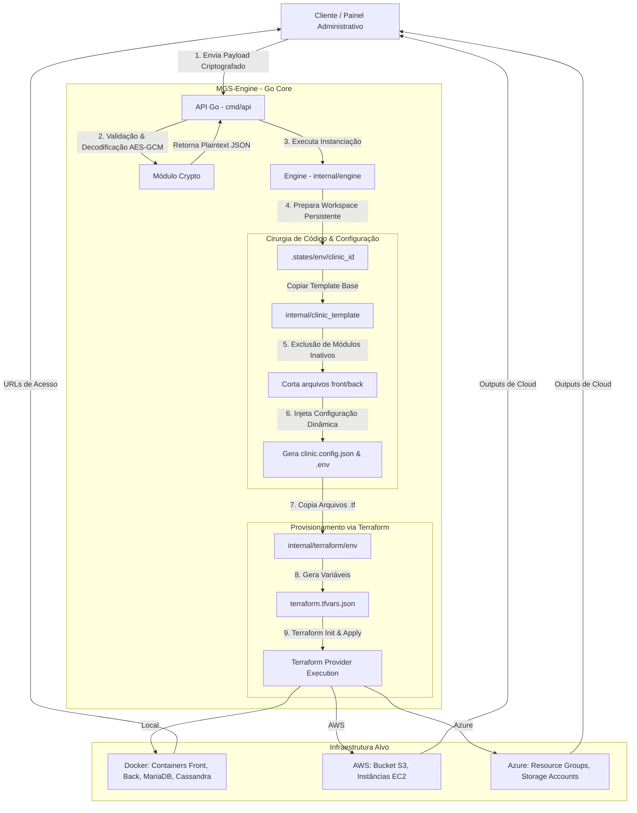

# Motor de Geração de Sistemas Clínicos sob Demanda (MGS-Clínico)

Este repositório contém o **MGS-Clínico (Motor de Geração de Sistemas Clínicos)**, um motor inteligente baseado em Go, Docker e Terraform projetado para o provisionamento automatizado de plataformas médicas completas e customizadas no modelo *Single-Tenant por Instância* (isolamento físico e lógico de dados). 

O sistema permite que administradores de clínicas configurem seus recursos ideais (identidade visual, módulos ativos e dimensionamento técnico) por meio de um portal administrativo. O motor processa essa solicitação de forma segura, customiza o código-fonte estático (front-end e back-end) através de um algoritmo de **Cirurgia de Código**, e orquestra a infraestrutura física ou em nuvem por meio de **Infraestrutura como Código (IaC)**.

---

## 📑 Sumário
1. [Conceito do Projeto](#-conceito-do-projeto)
2. [Arquitetura de Alto Nível](#-arquitetura-de-alto-nível)
3. [Estrutura do Repositório](#-estrutura-do-repositório)
4. [Ciclo de Execução da Engine](#-ciclo-de-execução-da-engine)
5. [Processo de Customização (Cirurgia de Código)](#-processo-de-customização-cirurgia-de-código)
6. [Segurança e Criptografia](#-segurança-e-criptografia)
7. [Mapeamento e Orquestração de Infraestrutura (IaC)](#-mapeamento-e-orquestração-de-infraestrutura-iac)
8. [Configuração do Payload (Schema JSON)](#-configuração-do-payload-schema-json)
9. [Instalação e Execução Local](#-instalação-e-execução-local)

---

## 💡 Conceito do Projeto

A grande maioria das soluções de *Software as a Service (SaaS)* no setor de saúde enfrenta desafios de privacidade e conformidade (como a LGPD no Brasil ou HIPAA nos EUA) devido ao uso de bancos de dados compartilhados (*Multi-Tenant* lógico). O **MGS-Clínico** resolve este gargalo ao implementar um paradigma de **SaaS Single-Tenant Híbrido**:

* **Isolamento de Dados Estrito:** Cada clínica possui seu próprio banco de dados relacional (MariaDB) e banco não-relacional (Cassandra), além de servidores dedicados (ou containers isolados).
* **Eficiência de Recursos:** Um algoritmo de "cirurgia de código" estática limpa os diretórios de código de arquivos e caminhos não contratados ou não utilizados (por exemplo, se o módulo médico não for selecionado, todos os arquivos, rotas e modelos do médico são excluídos antes da compilação). Isso diminui o tamanho final do artefato, reduz o consumo de memória e melhora a segurança.
* **Orquestração Declarativa:** Através do Terraform, a infraestrutura pode ser provisionada localmente (utilizando Docker para fins de desenvolvimento/homologação) ou escalada para nuvens públicas como AWS ou Azure.

---

## 🏗️ Arquitetura de Alto Nível

O fluxo completo desde a requisição de geração até a entrega do ambiente provisionado está ilustrado no diagrama abaixo:



---

## 📁 Estrutura do Repositório

O projeto segue as melhores práticas de layout de código em Go (Standard Go Project Layout):

```text
├── cmd/
│   └── api/
│       └── main.go                 # Ponto de entrada da API HTTP e roteador
├── internal/
│   ├── clinic_template/            # Código-fonte base autossuficiente das clínicas
│   │   ├── app/                    # Front-end em Next.js (TypeScript) com layouts modulares
│   │   ├── back-end/               # Back-end em Go (GORM, Go Chi/Gin, banco relacional)
│   │   ├── public/                 # Arquivos estáticos do Next.js (onde é injetado o clinic.config.json)
│   │   ├── package.json
│   │   └── tsconfig.json
│   ├── config/
│   │   └── config.go               # Leitura e parsing de variáveis de ambiente do motor (.env)
│   ├── crypto/
│   │   └── crypto.go               # Mecanismo de descriptografia de payloads e derivação de chaves
│   ├── engine/
│   │   └── engine.go               # Core do motor: copia templates, faz a cirurgia de código e chama o Terraform
│   ├── models/
│   │   └── payload.go              # Estruturas Go (Structs) que representam a configuração do sistema clínico
│   └── terraform/                  # Scripts e declarações do Terraform separadas por ambiente
│       ├── aws/                    # Arquivos .tf para nuvem Amazon Web Services (S3, EC2)
│       ├── azure/                  # Arquivos .tf para nuvem Microsoft Azure (Resource Group, Storage)
│       └── local/                  # Arquivos .tf para ambiente de desenvolvimento local (Docker Provider)
├── test/
│   └── obj_teste.json              # Modelo padrão de payload para testes locais de homologação
├── .env.example                    # Modelo de configuração de variáveis do motor
├── go.mod                          # Arquivo de módulos Go
└── README.md                       # Documentação principal
```

---

## 🔄 Ciclo de Execução da Engine

Quando a API recebe uma chamada no endpoint `/generate` ou `/generate-local`, as seguintes etapas ordenadas ocorrem:

1. **Autenticação e Descriptografia:** 
   O payload HTTP contendo as configurações de customização é descriptografado usando a chave derivada de forma segura (veja mais na seção [Segurança e Criptografia](#-segurança-e-criptografia)).
2. **Criação do Workspace da Clínica:** 
   É criado um diretório persistente e isolado sob a pasta `.states/<environment>/<clinic_id>`. Isto garante que o arquivo de estados (`terraform.tfstate`) de cada clínica fique isolado, permitindo manutenções e atualizações individuais futuras (*rolling updates* de infraestrutura).
3. **Cópia do Template do Sistema:**
   O template padrão localizado em `internal/clinic_template` é copiado integralmente para a nova pasta de trabalho (excluindo pastas desnecessárias para a compilação inicial como `.git`, `node_modules` e `.next`).
4. **Cirurgia de Código:**
   A engine analisa as escolhas dos módulos (`assistant`, `doctor`, `management`) feitas pelo cliente e apaga os arquivos de código correspondentes aos módulos desabilitados.
5. **Injeção de Configurações:**
   * **Front-end:** Cria o arquivo `/public/clinic.config.json` com paleta de cores, ID da clínica, e URL do back-end dinâmica.
   * **Back-end:** Cria o arquivo `.env` contendo as credenciais únicas de conexão de banco de dados geradas para aquela clínica.
   * **Imagens de Build:** Cria arquivos `Dockerfile` otimizados de múltiplos estágios (*multi-stage build*) para compilação estática do Next.js e compilação binária do Go.
6. **Orquestração da Infraestrutura:**
   * Mapeia os dados técnicos (dimensionamento de médicos e pacientes) para parâmetros de infraestrutura (por exemplo, definindo o tamanho da máquina EC2 na AWS: `t3.medium` para pequenas clínicas ou `m5.large` para clínicas de grande porte).
   * Copia os arquivos `.tf` correspondentes ao provedor alvo (`local`, `aws` ou `azure`).
   * Gera o arquivo `terraform.tfvars.json` com todas as variáveis necessárias.
   * Executa os processos do Terraform sequencialmente no diretório do workspace (`terraform init` e `terraform apply -auto-approve`).
7. **Retorno da Operação:**
   A API retorna os endereços IP ou endpoints gerados pela infraestrutura sob demanda para que o cliente possa acessar sua nova plataforma médica.

---

## ✂️ Processo de Customização (Cirurgia de Código)

A técnica de **Cirurgia de Código** implementada na engine é crucial para evitar o inchaço do software (*bloatware*) e assegurar que regras de negócio específicas estejam protegidas fisicamente no servidor.

No arquivo `internal/engine/engine.go`, a limpeza ocorre da seguinte forma:

```go
// Cirurgia no Front-end (Next.js App Router)
if !payload.Modules.Assistant.Enabled {
    os.RemoveAll(filepath.Join(frontTarget, "app", "assistant"))
}
if !payload.Modules.Doctor.Enabled {
    os.RemoveAll(filepath.Join(frontTarget, "app", "doctor"))
}
if !payload.Modules.Management.Enabled {
    os.RemoveAll(filepath.Join(frontTarget, "app", "management"))
}

// Cirurgia no Back-end (Go Models e Controllers)
if !payload.Modules.Assistant.Enabled {
    os.Remove(filepath.Join(backTarget, "internal", "models", "assistant.go"))
}
if !payload.Modules.Doctor.Enabled {
    os.Remove(filepath.Join(backTarget, "internal", "models", "doctor.go"))
}
```

Isso garante que ao rodar o comando de compilação ou de build de produção (ex. `npx next build` no Next.js), o compilador não inclua nenhum componente inativo no bundle final.

---

## 🔒 Segurança e Criptografia

O motor de geração de sistemas opera sob um princípio de *Zero-Trust* para trânsito de dados de configuração sensíveis.

1. **Derivação de Chaves (KDF):**
   A chave simétrica de 256 bits é gerada combinando dinamicamente o e-mail cadastrado da clínica, o CNPJ cadastrado e uma chave secreta interna do servidor (`OBJ_KEY`), aplicando um hash criptográfico seguro SHA-256:
   $$\text{Chave} = \text{SHA-256}(\text{Email} \mathbin{\Vert} \text{CNPJ} \mathbin{\Vert} \text{OBJ\_KEY})$$

2. **Algoritmo de Descriptografia:**
   Os dados de configuração da clínica trafegam em formato cifrado. O motor decodifica o payload utilizando o algoritmo **AES-256-GCM** (Galois/Counter Mode), garantindo simultaneamente **confidencialidade** (segredo dos dados) e **autenticidade/integridade** (verificação de que o payload não foi alterado no trânsito via Tag GCM).

---

## ⚙️ Mapeamento e Orquestração de Infraestrutura (IaC)

A engine mapeia os metadados do payload em parâmetros de recursos de nuvem de acordo com as necessidades técnicas declaradas pelo cliente.

### Mapeamento Técnico de Dimensionamento
A engine avalia o volume estimado de médicos para dimensionar os recursos computacionais necessários:
* Se $\text{Quantidade de Médicos} \le 5$, é mapeada uma instância com melhor custo-benefício (Ex: `t3.medium` na AWS).
* Se $\text{Quantidade de Médicos} > 5$, a engine escala a infraestrutura para máquinas focadas em computação e memória robustas (Ex: `m5.large` na AWS).
* Para o ambiente local de homologação, a engine mapeia para containers Docker (`local-docker`).

### Provedores de Infraestrutura Suportados

#### 1. Local (Docker Provider)
No desenvolvimento local, o Terraform interage com o Daemon do Docker local para criar:
* Uma rede privada Docker dedicada (`<safe_name>_net_<id>`).
* Um container de banco de dados MariaDB (`gorm.io/driver/mysql` integrado ao back-end).
* Um container de banco de dados Cassandra para registros volumosos.
* Build e inicialização do container do Front-end (Next.js) expondo a porta `3000`.
* Build e inicialização do container do Back-end (Go) expondo a porta `8081`.

#### 2. Nuvem (AWS Provider)
* Provisiona um **Bucket S3** criptografado exclusivo para guardar documentos médicos digitais (prescrições com assinatura digital, arquivos carregados e exames) com políticas de controle de acesso restrito.
* Provisiona instâncias virtuais EC2 baseadas na escala definida na engine.

#### 3. Nuvem (Azure Provider)
* Provisiona um **Grupo de Recursos (Resource Group)** para cada clínica.
* Cria um **Storage Account** dedicado. A propriedade de redundância de dados muda conforme a contratação de Disaster Recovery (`dr_enabled`): se ativado, provisiona armazenamento geo-redundante (**GRS**); caso contrário, armazenamento localmente redundante (**LRS**).

---

## 📄 Configuração do Payload (Schema JSON)

O motor aguarda um JSON de configuração estruturado que determina a identidade e o comportamento das aplicações. A estrutura em Go é definida em `internal/models/payload.go`. Abaixo, um exemplo de objeto representativo (como o encontrado em `test/obj_teste.json`):

```json
{
    "id": "8e5080b7-b72d-476d-85ce-6abbee6e99ee",
    "createdAt": "2026-05-26T20:00:00.000Z",
    "version": "1.0.0",
    "identity": {
        "clinicName": "Clinica Sorriso Saudavel",
        "logoFile": null,
        "logoFileName": null,
        "logoType": "generic",
        "palette": "blue"
    },
    "implementation": {
        "address": "Av. Paulista, 1000 - Sao Paulo",
        "type": "managed"
    },
    "modules": {
        "assistant": {
            "enabled": true,
            "features": {
                "billing": true,
                "billingCheckControl": true,
                "checkInOut": true,
                "doctorScheduleView": true,
                "insurancePlans": true,
                "patientManagement": true,
                "scheduling": true
            },
            "scope": "global"
        },
        "doctor": {
            "enabled": true,
            "features": {
                "consultationHistory": true,
                "dashboard": true,
                "patientList": true,
                "patientRecord": {
                    "aiEcg": true,
                    "allergies": true,
                    "digitalSignature": true,
                    "enabled": true,
                    "fileUpload": true,
                    "files": true,
                    "medicationControl": true,
                    "prescriptionTemplate": true,
                    "prescriptions": true,
                    "stampedPrescription": true
                },
                "schedule": true
            }
        },
        "management": {
            "enabled": true,
            "features": {
                "attendanceControl": true,
                "billingByDoctor": true,
                "billingControl": true,
                "dashboards": true,
                "doctorSchedules": true,
                "staffRegistration": true,
                "systemCost": true
            }
        },
        "shared": {
            "settings": true
        }
    },
    "technical": {
        "deploymentType": "web",
        "drSecondaryEnv": null,
        "environment": "local",
        "estimatedPrice": {
            "currency": "BRL",
            "monthly": 1850.00,
            "setup": 1500.00
        },
        "hasDisasterRecovery": false,
        "sizing": {
            "avgAssistants": 2,
            "avgDoctors": 8,
            "maxPatients": 500,
            "minPatients": 100
        }
    }
}
```

---

## 🛠️ Instalação e Execução Local

### Pré-requisitos
* **Go Compiler** (versão 1.20 ou superior)
* **Docker Desktop** ativo na máquina de execução
* **Terraform CLI** (instalado e configurado no PATH do sistema operacional)

### 1. Configuração do Ambiente
Crie um arquivo `.env` na raiz do diretório do motor seguindo o modelo abaixo:

```ini
PORT=8080
OBJ_KEY=sua_chave_secreta_aqui_para_criptografia

# Credenciais AWS (Opcional - Necessárias se environment for aws)
AWS_REGION=us-east-1
AWS_ACCESS_KEY_ID=
AWS_SECRET_ACCESS_KEY=
AWS_SESSION_TOKEN=
```

### 2. Inicialização do Motor de Geração
Para iniciar a API HTTP do motor localmente:

```bash
go run cmd/api/main.go
```

Você verá a saída indicando que o servidor está rodando:
`Motor de Geração iniciado na porta 8080...`

### 3. Executando um Teste de Provisionamento Local
Com o motor ativo, envie uma requisição POST para o endpoint `/generate-local` para simular o recebimento de um cadastro. Este endpoint lerá o arquivo padrão de testes `test/obj_teste.json`, processará a cirurgia de código e provisionará a infraestrutura local em containers:

**Via PowerShell / WSL:**
```bash
curl -X POST http://localhost:8080/generate-local
```

### 4. Monitoramento da Infraestrutura Gerada
Durante a execução do Terraform, o motor exibirá os logs detalhados de provisionamento no terminal. Ao final do processo, você poderá visualizar os containers gerados executando:

```bash
docker ps
```

O diretório `.states/local/8e5080b7-b72d-476d-85ce-6abbee6e99ee` conterá os arquivos finais customizados da clínica gerados pela cirurgia de código, bem como o estado local do Terraform.
